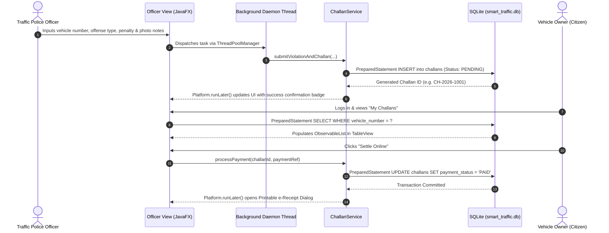

# Smart Traffic Police Management System (STPMS)
## Advanced Java Academic Project — 3-Minute Code & Architecture Walkthrough

---

### Quick Project Summary Table

| Category | Technical Specification |
| :--- | :--- |
| **Language & Platform** | **Java 21 LTS** (JDK 21) |
| **User Interface** | **JavaFX Desktop** (Slate/Navy Dark Theme, Responsive CSS) |
| **Database Engine** | **SQLite (Relational Database)** via **Xerial JDBC Driver** |
| **Database Location** | `smart_traffic.db` (Local persistent file in project directory) |
| **Software Architecture** | **5-Tier MVC Pattern** (Model, View, Controller, Service, DAO) |
| **Build & Dependencies** | **Apache Maven** (`pom.xml`) |
| **Total Codebase** | **82 Java Source Classes** (Zero monolithic design) |

---

## 1. Two-Minute Viva Presentation Script (Read Out in Viva / Exam)

> *"Good morning, Professor.*
> 
> *Our project is the **Smart Traffic Police Management System**, an Advanced Java desktop application built using **Java 21**, **JavaFX**, and **SQLite JDBC**.*
> 
> *The system modernizes urban traffic operations by connecting three key user groups:*
> 1. ***System Administrators***, *who monitor force deployments, manage junction signals, audit daily attendance muster rolls, and dispatch emergency units.*
> 2. ***Field Traffic Officers***, *who view today's assigned beat, mark biometric attendance, log violations on-site, and issue instant digital e-Challans.*
> 3. ***Citizens***, *who can look up vehicle citations, pay fines online through a simulated digital gateway, generate official printable receipts, and report road hazards or broken signals.*
> 
> *From a software engineering perspective, we implemented a **5-tier MVC architecture** separating Models, Views, Controllers, Business Services, and Data Access Objects (DAOs).*
> 
> *We extensively demonstrated core Advanced Java principles, including:*
> - *Object-Oriented **Inheritance & Encapsulation** across user and domain entities.*
> - *Generic **Interfaces & Abstraction** in our DAO layer.*
> - *Custom **Exception Handling** preventing application crashes.*
> - *Native **JDBC Transactions and PreparedStatements** ensuring ACID compliance and complete immunity against SQL injection.*
> - *And **Multithreading via ExecutorService**, executing database queries asynchronously on background daemon threads so the JavaFX user interface never lags or freezes.*
> 
> *Thank you."*

---

## 2. Main Code Packages & Their Responsibilities

The codebase is organized cleanly under `com.smarttraffic.*` ensuring strict separation of concerns:

```
src/main/java/com/smarttraffic/
├── controller/         # MVC View-Controllers handling user input and button actions
│   ├── LoginController.java
│   ├── MainLayoutController.java
│   ├── admin/          # Admin controllers (Dashboard, Officers, Junctions, Duty, Attendance, Challans, Complaints, Emergency)
│   ├── officer/        # Officer controllers (Duty, LogViolation, Challans, Complaints, Emergency)
│   └── citizen/        # Citizen controllers (Dashboard, Challans, FileComplaint, History)
├── model/              # Domain entities encapsulating private data with getters/setters
│   ├── User.java, AdminUser.java, Officer.java, Citizen.java
│   ├── Challan.java, ViolationType.java, Junction.java, DutyAssignment.java
│   ├── Attendance.java, Complaint.java, EmergencyReport.java, Evidence.java
│   └── enums/          # Typed constants (Role, ChallanStatus, ShiftType, EmergencySeverity)
├── dao/                # Data Access Objects executing parameterized JDBC SQL queries
│   ├── DatabaseManager.java  # Connection manager, SQLite schema setup & PRAGMA foreign keys
│   ├── BaseDao.java          # Generic DAO contract
│   ├── OfficerDao.java, JunctionDao.java, ChallanDao.java, ComplaintDao.java, etc.
├── service/            # Business logic, status state-machine transitions, and transactions
│   ├── AuthService.java, ChallanService.java, DutyService.java, ReportService.java, etc.
├── view/               # Reusable UI components, scene coordination, and modals
│   ├── ViewNavigator.java    # Dynamic stage and scene switcher
│   ├── UIComponents.java     # KPI stat cards, badges, and alerts
│   └── ChallanReceiptDialog.java # Official printable e-Challan receipt modal
└── util/               # Security, date helpers, and background threading
    ├── ThreadPoolManager.java# Concurrency ExecutorService thread pool
    ├── PasswordUtil.java     # SHA-256 cryptographic password hashing
    └── DateUtil.java         # Timestamp and date formatters
```

---

## 3. Advanced Java Concepts Demonstrated in Code

| Advanced Java Concept | How It Is Implemented | Exact File Reference |
| :--- | :--- | :--- |
| **Encapsulation** | All entity fields are `private` with validated getters/setters, defensive copies, and domain integrity rules. | `Challan.java`, `Officer.java`, `Complaint.java` |
| **Inheritance & Hierarchy** | `BaseEntity` shares ID and auditing timestamps; `User` is an abstract base class extended by `AdminUser`, `Officer`, and `Citizen`. | `model/User.java`, `model/AdminUser.java`, `model/Officer.java` |
| **Abstraction & Interfaces** | `BaseDao<T, ID>` generic interface defines standard CRUD contracts decoupling services from SQLite JDBC implementation. | `dao/BaseDao.java`, `dao/OfficerDao.java`, `service/ReportService.java` |
| **Polymorphism** | Dynamic method dispatch in user permissions and polymorphic report generators compiling Violation, Revenue, and Accident summaries. | `service/ReportService.java` |
| **Custom Exception Handling** | Custom checked exception hierarchy (`SmartTrafficException`, `DatabaseException`, `ValidationException`) ensuring graceful JavaFX alerts without terminating the process. | `exception/DatabaseException.java`, `view/ViewNavigator.java` |
| **Collections Framework** | Heavy usage of JavaFX `ObservableList` for live reactive tables; `HashMap` and Java Streams for analytical groupings (`groupingBy()`, `summingDouble()`). | `OfficerManagementController.java`, `ReportsAnalyticsController.java` |
| **JDBC Transactions & PreparedStatement** | 100% parameterized queries (`ps.setString()`, `ps.setInt()`) preventing SQL injection; multi-table atomic transactions (`setAutoCommit(false)`, `commit()`, `rollback()`). | `dao/DatabaseManager.java`, `dao/ChallanDao.java` |
| **Multithreading & Concurrency** | Dedicated `ThreadPoolManager` (ExecutorService) executing heavy database queries on daemon threads, pushing UI updates back via `Platform.runLater()`. | `util/ThreadPoolManager.java`, `controller/admin/AdminDashboardController.java` |

---

## 4. End-to-End Pipeline: Violation Issuance to Digital Settlement



---

## 5. Top 5 Viva / Exam Questions & Instant Answers

### Q1: Where and how is the project data stored?
> **Answer**: All application data persists in a local SQLite relational database file named `smart_traffic.db` located in the project root directory. We connect using the official `org.sqlite.JDBC` driver with foreign key constraints enforced (`PRAGMA foreign_keys = ON;`).

### Q2: How did you implement Multithreading, and why was it necessary?
> **Answer**: We implemented a singleton `ThreadPoolManager` that manages an `ExecutorService` fixed pool of daemon threads. It was necessary because executing database I/O directly on the JavaFX Application Thread would freeze the user interface. Heavy queries run on background threads, and UI updates are safely dispatched back using `Platform.runLater()`.

### Q3: How does the code prevent SQL Injection attacks?
> **Answer**: We never concatenate user inputs into SQL strings. 100% of our database operations use parameterized JDBC `PreparedStatement` instances with typed positional placeholders (`?`) and `set` methods (`ps.setString()`, `ps.setInt()`, `ps.setDouble()`).

### Q4: How is the MVC (Model-View-Controller) pattern implemented?
> **Answer**:
> - **Model** (`com.smarttraffic.model`): Pure domain entity classes holding private data and business state.
> - **View** (`com.smarttraffic.view` + CSS): Programmatic JavaFX layouts and styling without business logic.
> - **Controller** (`com.smarttraffic.controller`): Event-driven classes mediating between UI controls and the service layer.
> - **DAO / Service** (`com.smarttraffic.dao` & `com.smarttraffic.service`): Decoupled business logic and database execution.

### Q5: What happens if an officer or citizen inputs invalid data?
> **Answer**: Input validation is enforced using regex and business rules before reaching the database. If invalid (e.g., empty vehicle plate or malformed phone number), a custom `ValidationException` is thrown, caught by the controller, and displayed as a clean warning dialog (`Alert.AlertType.WARNING`) while preserving user input.
