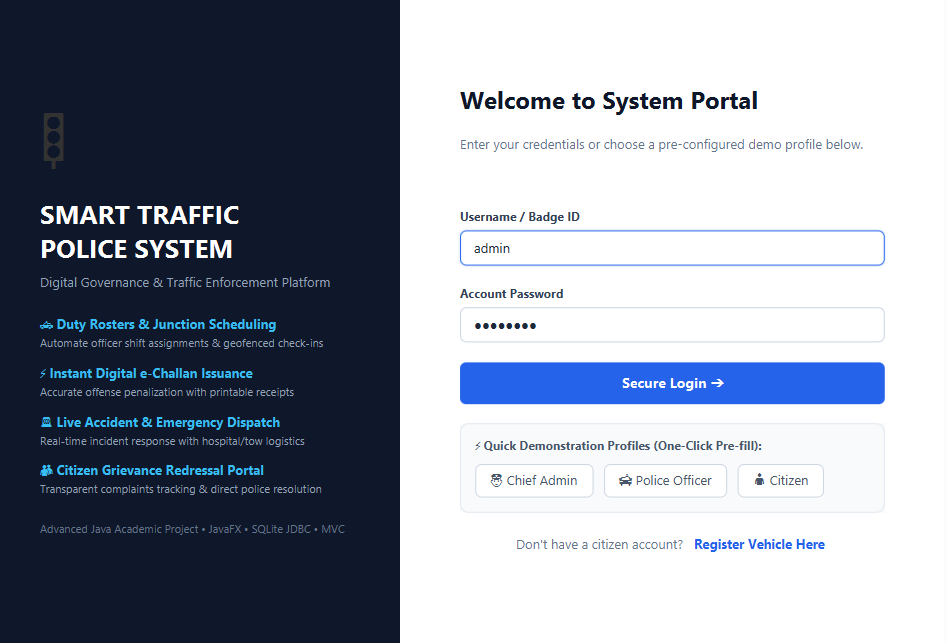
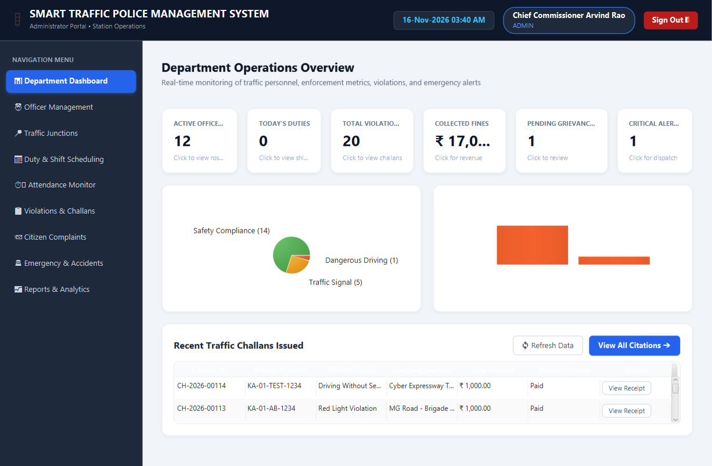
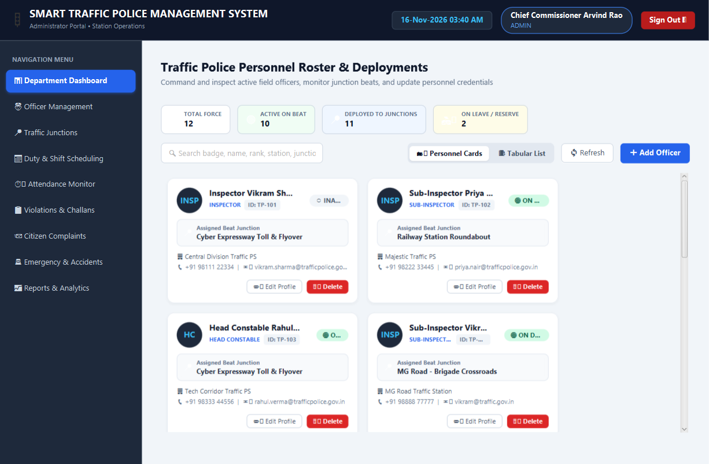
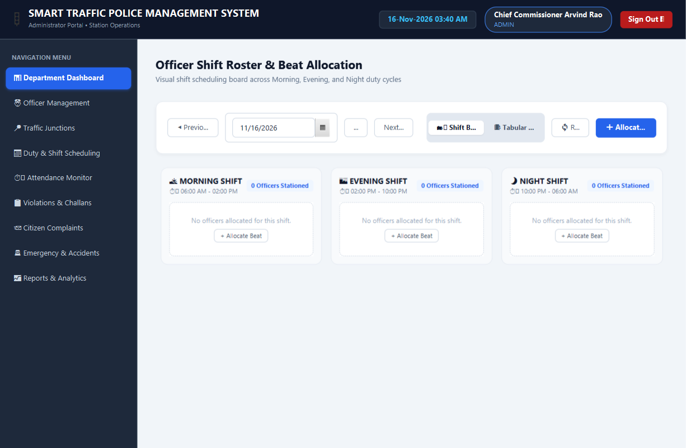
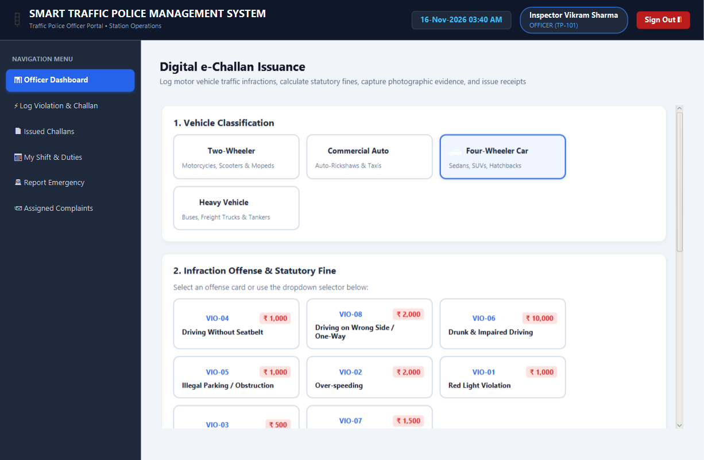
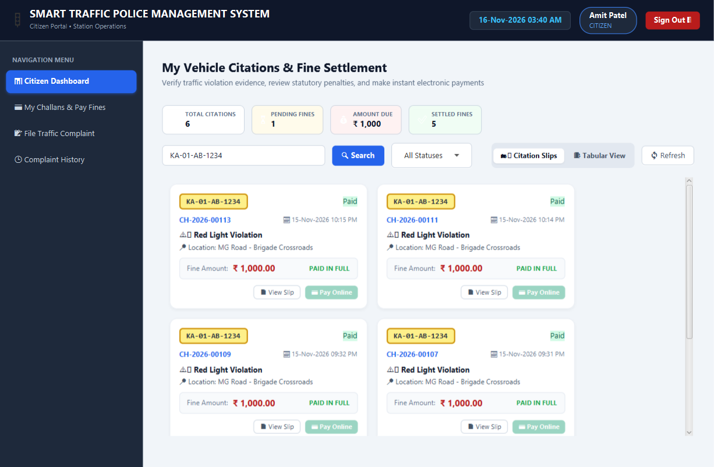

# Smart Traffic Police Management System 🚦

An Advanced Java desktop application engineered with **Java 21**, **JavaFX**, **SQLite (JDBC)**, and a clean **MVC (Model-View-Controller)** architecture for academic evaluation and traffic police operational management.

---

## 🌟 Key Highlights

- **Desktop-First Architecture**: Pure JavaFX desktop UI with a modern Slate/Cobalt responsive theme—no web servers, no Spring Boot, no React/Node.js.
- **Role-Based Workflows**: Tailored, isolated interfaces and dashboards for **Admin**, **Traffic Police Officers**, and **Citizens**.
- **Full SQLite JDBC Persistence**: Comprehensive relational schema covering personnel, junctions, duty allocations, attendance, violation catalogs, digital challans, citizen grievances, emergency collisions, and photographic evidence.
- **Interactive Visualizations & Printing**: Live digital clock, real-time KPI metrics, JavaFX `PieChart` and `BarChart` analytics, and an official **printable/exportable e-Challan receipt slip** generator.
- **Demonstration Ready**: Comes pre-seeded with realistic officers, junctions, duty rosters, challans, citizen accounts, and emergency reports for instant examination.

---

## 🏛️ Advanced Java Concepts Demonstrated

| Advanced Java Concept | Implementation Details | Key Classes & References |
| :--- | :--- | :--- |
| **Abstraction** | Abstract base classes and generic DAO contracts hiding implementation details. | `User.java` (abstract), `BaseDao<T, ID>` (generic interface) |
| **Inheritance** | Specialized user domain models extending common authentication and contact traits. | `AdminUser extends User`, `Officer extends User`, `Citizen extends User` |
| **Polymorphism** | Dynamic method dispatch in user role privileges, and polymorphic report generators producing distinct analytics summaries via a unified interface. | `ReportService.ReportGenerator`, `ViolationSummaryReport`, `RevenueCollectionReport`, `AccidentSummaryReport` |
| **Encapsulation** | Private fields with validated accessor/mutator methods and domain-level integrity rules. | `Challan.java`, `Officer.java`, `DutyAssignment.java`, `Complaint.java` |
| **Interfaces** | Generic Data Access Object pattern and report generation abstraction contracts. | `BaseDao<T, ID>`, `ReportGenerator` |
| **Exception Handling** | Custom checked exception hierarchy ensuring robust error propagation and friendly user alerts without crashing. | `SmartTrafficException`, `AuthenticationException`, `ValidationException`, `DatabaseException` |
| **Collections Framework** | Heavy usage of `ArrayList`, `HashMap`, `LinkedHashMap`, `FilteredList`, and Java 8+ Streams (`stream().filter().collect()`, `groupingBy()`, `summingDouble()`). | `ReportService.java`, `ChallanDao.java`, `OfficerManagementController.java` |
| **Multithreading** | Asynchronous execution of database queries, background report compilation, and periodic UI clock updates using thread pools and daemon threads. | `ThreadPoolManager.java`, `AdminDashboardController.java`, `ReportsAnalyticsController.java` |
| **JDBC & Transactions** | Native JDBC `PreparedStatement`, `ResultSet`, connection pooling, generated keys, and atomic multi-table transactions (`setAutoCommit(false)`, `commit()`, `rollback()`). | `DatabaseManager.java`, `UserDao.java`, `OfficerDao.java` |
| **MVC Architecture** | Strict separation of business models (`model`), database access (`dao`), business rules (`service`), and user interface (`view` & `controller`). | Clean package decomposition across `com.smarttraffic.*` |

---

## 👥 User Roles & Capabilities

### 1. 👮 System Administrator
- **Dashboard Analytics**: Real-time counter cards (total officers, active duties, citations, fine revenue, open grievances, collisions) with visual charts.
- **Officer Management**: Register new traffic officers, assign ranks, police stations, duty beats, and modify active statuses.
- **Traffic Junction Management**: Configure intersection coordinates, landmarks, areas, and hazard/congestion risk ratings.
- **Duty & Shift Scheduling**: Allocate officers to morning, evening, or night shifts for targeted intersections with duty notes.
- **Attendance Monitoring**: Audit daily check-in / check-out timestamps and manual attendance overrides.
- **Challan Administration**: Review citations issued across all junctions, inspect violation evidence, and process offline counter fine payments.
- **Citizen Complaints Redressal**: Assign field officers to investigate complaints, update status (*Pending*, *Investigating*, *Resolved*, *Rejected*), and append resolution logs.
- **Accident & Emergency Control**: Log collision reports, dispatch ambulances, tow cranes, and road clearance units.
- **Executive Reports**: Asynchronously compile and export Violation Breakdown, Revenue Recovery, and Accident Severity reports to text files.

### 2. 🚔 Traffic Police Officer
- **Officer Console**: View assigned junction beat, today's shift details, and immediate shift check-in / check-out buttons.
- **Log Violations & Issue e-Challan**: Fast citation recording by vehicle number, category (Two-wheeler, Car, Heavy, etc.), offense type, calculated fine, photographic evidence, and immediate **Printable Challan Slip** generation.
- **Issued Challans Registry**: Review personal enforcement records and reprint receipts anytime.
- **Assigned Complaints**: Investigate complaints assigned to the officer's junction beat and log resolution outcomes.
- **Emergency Incident Dispatch**: Dispatch on-the-spot accident alerts with casualty counts and logistical assistance needs.

### 3. 👤 Citizen
- **Registration & Authentication**: Self-service account registration with Driving License (DL) and registered vehicle number.
- **Citizen Dashboard**: Overview of citations associated with their vehicle and status of filed grievances.
- **Challan Inquiry & Online Settlement**: Search citations by vehicle number, review violation reasons and photographic evidence, and settle fines via a simulated digital payment gateway (UPI, Cards, NetBanking) with immediate settled receipt generation.
- **File Traffic Grievance**: Report illegal parking obstruction, broken traffic lights, reckless driving, or road hazards with optional photo evidence.
- **Complaint History**: Track investigation progress and read police resolution remarks.

---

## 🔑 Pre-Seeded Demonstration Credentials

For instant demonstration and university grading, the application features a **One-Click Demo Pre-Fill** on the login screen. You can also manually sign in with:

| Role | Username | Password | Notes |
| :--- | :--- | :--- | :--- |
| **Chief Admin** | `admin` | `admin123` | Full access to all administrative modules and analytics |
| **Police Officer 1** | `officer1` | `officer123` | Inspector Vikram Sharma (Badge `TP-101`), MG Road Junction |
| **Police Officer 2** | `officer2` | `officer123` | Sub-Inspector Priya Nair (Badge `TP-102`), Majestic Roundabout |
| **Police Officer 3** | `officer3` | `officer123` | Head Constable Rahul Verma (Badge `TP-103`), Tech Corridor Flyover |
| **Citizen 1** | `citizen1` | `citizen123` | Amit Patel (Vehicle `KA-01-AB-1234`) |
| **Citizen 2** | `citizen2` | `citizen123` | Sneha Reddy (Vehicle `KA-05-MN-5678`) |

---

## 🗄️ Relational Database Schema (SQLite)

The database file `smart_traffic.db` is automatically created and populated upon application launch with foreign keys enforced:

1. `users`: `id`, `username`, `password_hash`, `role`, `full_name`, `email`, `phone`, `created_at`
2. `officers`: `id`, `user_id` (FK), `badge_number`, `rank`, `police_station`, `status`, `assigned_junction_id` (FK)
3. `citizen_profiles`: `id`, `user_id` (FK), `dl_number`, `vehicle_number`, `address`
4. `junctions`: `id`, `junction_code`, `name`, `area`, `landmark`, `latitude`, `longitude`, `risk_level`
5. `duty_assignments`: `id`, `officer_id` (FK), `junction_id` (FK), `shift`, `duty_date`, `start_time`, `end_time`, `status`, `notes`
6. `attendance`: `id`, `officer_id` (FK), `duty_id` (FK), `attendance_date`, `check_in_time`, `check_out_time`, `status`, `remarks`
7. `violations`: `id`, `violation_code`, `title`, `category`, `description`, `standard_fine_amount`
8. `challans`: `id`, `challan_number`, `vehicle_number`, `vehicle_type`, `violator_name`, `violator_phone`, `officer_id` (FK), `junction_id` (FK), `violation_id` (FK), `violation_date`, `fine_amount`, `payment_status`, `payment_date`, `payment_reference`, `evidence_file_path`, `remarks`
9. `complaints`: `id`, `complaint_number`, `citizen_id` (FK), `junction_id` (FK), `complaint_type`, `vehicle_number`, `description`, `incident_date`, `status`, `assigned_officer_id` (FK), `officer_action_notes`, `evidence_file_path`, `created_at`, `updated_at`
10. `emergency_reports`: `id`, `report_number`, `officer_id` (FK), `junction_id` (FK), `accident_type`, `severity`, `vehicles_involved`, `casualties_count`, `ambulance_required`, `tow_truck_required`, `road_blocked`, `report_time`, `status`, `notes`
11. `evidence`: `id`, `entity_type`, `entity_id`, `file_path`, `file_name`, `file_size`, `description`, `uploaded_at`

---

## 🚀 Execution & Setup Instructions

### Prerequisites
- **Java Development Kit (JDK)**: Version 21 or higher (OpenJDK, Oracle JDK, Eclipse Temurin).
- **Apache Maven**: Version 3.8+ (included in standard IDEs).

### Option 1: One-Click Execution (Windows)
Double-click `run.bat` or execute in PowerShell:
```powershell
.\run.ps1
```

### Option 2: Running via Maven Command Line
In the project root folder:
```bash
# 1. Compile the application
mvn clean compile

# 2. Run the JavaFX desktop application
mvn javafx:run
```

*Or via the standard launcher class:*
```bash
mvn compile exec:java -Dexec.mainClass="com.smarttraffic.SmartTrafficAppLauncher"
```

### Option 3: Running Unit Tests
To run the automated test suite verifying database initialization, authentication, challans, and reports:
```bash
mvn test
```

### Option 4: Running in IntelliJ IDEA / VS Code / Eclipse
1. Open the project folder in your IDE.
2. Allow Maven to import dependencies from `pom.xml`.
3. Locate `SmartTrafficAppLauncher.java` in `src/main/java/com/smarttraffic/SmartTrafficAppLauncher.java`.
4. Right-click and select **Run 'SmartTrafficAppLauncher.main()'**.

---

## 📁 Project Directory Structure

```
smart-traffic-police-system/
├── pom.xml                                   # Maven configuration with JavaFX 21 & SQLite JDBC
├── run.bat                                   # One-click Windows startup script
├── run.ps1                                   # One-click PowerShell startup script
├── README.md                                 # Complete documentation & grading guide
├── src/
│   ├── main/
│   │   ├── java/com/smarttraffic/
│   │   │   ├── SmartTrafficApp.java          # JavaFX Application lifecycle
│   │   │   ├── SmartTrafficAppLauncher.java  # Main entry launcher
│   │   │   ├── model/                        # Domain Models & OOP Hierarchies
│   │   │   │   ├── User.java                 # Abstract base user class
│   │   │   │   ├── AdminUser.java            # Administrator entity (Inheritance)
│   │   │   │   ├── Officer.java              # Police Officer entity (Inheritance)
│   │   │   │   ├── Citizen.java              # Citizen entity (Inheritance)
│   │   │   │   ├── Junction.java             # Traffic junction model
│   │   │   │   ├── DutyAssignment.java       # Duty shift assignment model
│   │   │   │   ├── Attendance.java           # Daily check-in/out attendance model
│   │   │   │   ├── ViolationType.java        # Standard offenses & statutory fines
│   │   │   │   ├── Challan.java              # Digital e-Challan notice model
│   │   │   │   ├── Complaint.java            # Citizen grievance report model
│   │   │   │   ├── EmergencyReport.java      # Accident & emergency report model
│   │   │   │   ├── Evidence.java             # Photographic evidence model
│   │   │   │   └── enums/                    # Strongly-typed domain enumerations
│   │   │   │       ├── Role.java
│   │   │   │       ├── VehicleType.java
│   │   │   │       ├── ShiftType.java
│   │   │   │       ├── DutyStatus.java
│   │   │   │       ├── AttendanceStatus.java
│   │   │   │       ├── ChallanStatus.java
│   │   │   │       ├── ComplaintStatus.java
│   │   │   │       ├── EmergencySeverity.java
│   │   │   │       ├── EmergencyStatus.java
│   │   │   │       └── RiskLevel.java
│   │   │   ├── dao/                          # JDBC Data Access Layer (Transactions & Queries)
│   │   │   │   ├── DatabaseManager.java      # SQLite connection & schema seeding
│   │   │   │   ├── BaseDao.java              # Generic DAO interface
│   │   │   │   ├── UserDao.java
│   │   │   │   ├── OfficerDao.java
│   │   │   │   ├── JunctionDao.java
│   │   │   │   ├── DutyDao.java
│   │   │   │   ├── AttendanceDao.java
│   │   │   │   ├── ViolationDao.java
│   │   │   │   ├── ChallanDao.java
│   │   │   │   ├── ComplaintDao.java
│   │   │   │   ├── EmergencyDao.java
│   │   │   │   └── EvidenceDao.java
│   │   │   ├── service/                      # Business Logic & Analytics Services
│   │   │   │   ├── AuthService.java          # Authentication & session tracking
│   │   │   │   ├── OfficerService.java       # Personnel deployments
│   │   │   │   ├── JunctionService.java      # Intersection management
│   │   │   │   ├── DutyService.java          # Shifts and daily attendance
│   │   │   │   ├── ChallanService.java       # Citations and payments
│   │   │   │   ├── ComplaintService.java     # Grievances & investigations
│   │   │   │   ├── EmergencyService.java     # Accident logistics & dispatch
│   │   │   │   ├── ReceiptService.java       # Challan slip text formatting
│   │   │   │   └── ReportService.java        # Polymorphic analytics synthesis
│   │   │   ├── exception/                    # Custom Checked Exception Hierarchy
│   │   │   │   ├── SmartTrafficException.java
│   │   │   │   ├── AuthenticationException.java
│   │   │   │   ├── ValidationException.java
│   │   │   │   └── DatabaseException.java
│   │   │   ├── util/                         # Concurrency, Security, & Date Utilities
│   │   │   │   ├── PasswordUtil.java         # SHA-256 cryptographic hashing
│   │   │   │   ├── DateUtil.java             # DateTime formatters
│   │   │   │   └── ThreadPoolManager.java    # Multithreading executor
│   │   │   ├── view/                         # Reusable View Components & Modals
│   │   │   │   ├── ViewNavigator.java        # Scene coordination
│   │   │   │   ├── UIComponents.java         # KPI cards, badges, alerts
│   │   │   │   └── ChallanReceiptDialog.java # Printable e-Challan receipt dialog
│   │   │   └── controller/                   # JavaFX Controllers (MVC View-Controller)
│   │   │       ├── LoginController.java      # Login view with demo pre-fill buttons
│   │   │       ├── RegisterController.java   # Citizen self-registration
│   │   │       ├── MainLayoutController.java # Top bar, live clock, role-specific sidebar
│   │   │       ├── admin/                    # Admin module controllers (8 views)
│   │   │       │   ├── AdminDashboardController.java
│   │   │       │   ├── OfficerManagementController.java
│   │   │       │   ├── JunctionManagementController.java
│   │   │       │   ├── DutyAllocationController.java
│   │   │       │   ├── AttendanceMonitorController.java
│   │   │       │   ├── AdminChallansController.java
│   │   │       │   ├── AdminComplaintsController.java
│   │   │       │   ├── AdminEmergencyController.java
│   │   │       │   └── ReportsAnalyticsController.java
│   │   │       ├── officer/                  # Officer module controllers (6 views)
│   │   │       │   ├── OfficerDashboardController.java
│   │   │       │   ├── LogViolationController.java
│   │   │       │   ├── OfficerChallansController.java
│   │   │       │   ├── OfficerDutyController.java
│   │   │       │   ├── OfficerComplaintsController.java
│   │   │       │   └── ReportEmergencyController.java
│   │   │       └── citizen/                  # Citizen module controllers (4 views)
│   │   │           ├── CitizenDashboardController.java
│   │   │           ├── CitizenChallansController.java
│   │   │           ├── FileComplaintController.java
│   │   │           └── CitizenComplaintsHistoryController.java
│   │   └── resources/
│   │       ├── css/
│   │       │   └── style.css                 # Modern Navy/Slate JavaFX UI stylesheet
│   │       └── sample_evidence/              # Sample camera captures
│   └── test/
│       └── java/com/smarttraffic/
│           └── SmartTrafficSystemTest.java   # Automated JUnit 5 integration test suite
```

---

## 📸 System Screenshots & UI Gallery

A comprehensive operational walkthrough and high-resolution visual report is available in **[SYSTEM_REPORT.md](SYSTEM_REPORT.md)**.

| Portal Login & Quick Fill | Executive Admin Dashboard |
| :---: | :---: |
|  |  |

| Officer Cadre Management (CRUD) | Tri-Shift Duty Allocation Board |
| :---: | :---: |
|  |  |

| Rapid Violation & e-Challan Logger | Citizen Digital Settlement Portal |
| :---: | :---: |
|  |  |

---

## ⚖️ Legal & Academic Disclaimer
This desktop software is an **academic project developed for an Advanced Java course**. It simulates traffic enforcement, e-challans, and emergency responses for educational demonstration purposes only and is not connected to any official government database.
